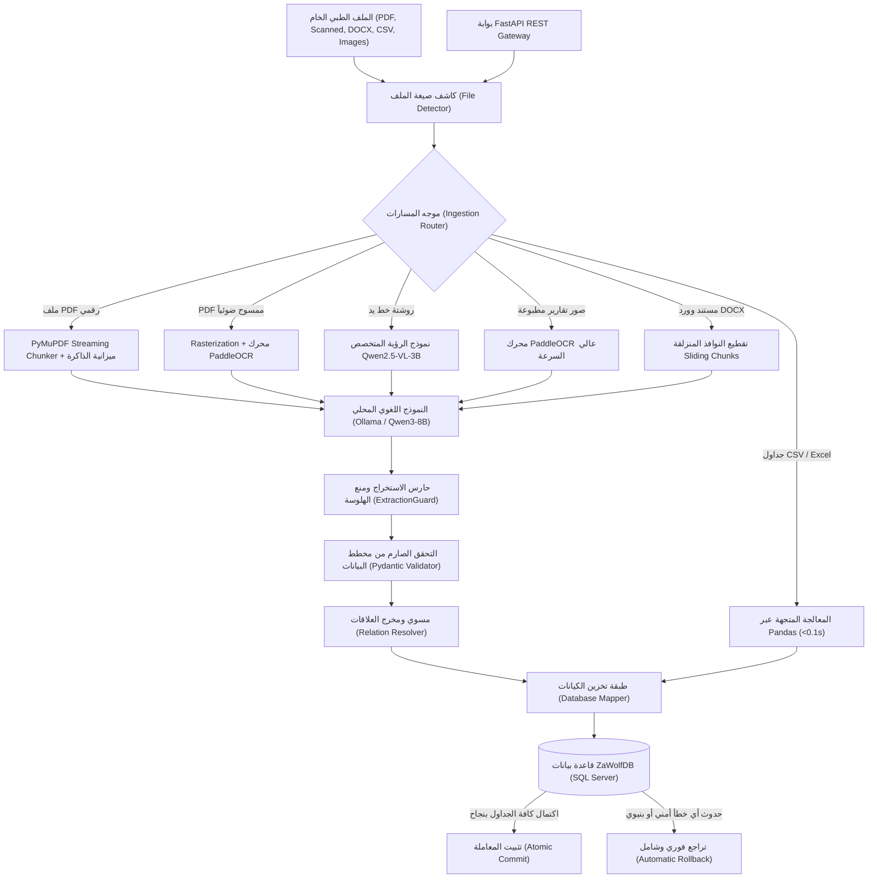

# 🐺 دليل مشروع ZaWolf المعماري والتشغيلي النهائي
### **الموسوعة الهندسية الشاملة لمنظومة معالجة وأرشفة المستندات الطبية والتعرف الضوئي (OCR) وقواعد البيانات العلائقية**

---

## 📌 معلومات الإصدار والمشروع
* **اسم المشروع:** منظومة ZaWolf الطبية (ZaWolf Medical Document Processing Pipeline)
* **مهندس المشروع:** م. سعد تامر (AI & Data Engineer)
* **تاريخ الإصدار النهائي:** أكتوبر 2026
* **رقم الإصدار:** Production Release v1.0.0 (Zero-Regression Verified)
* **بيئة التشغيل:** محلية 100% (On-Premise / Local) متوافقة مع معايير حماية بيانات المرضى (HIPAA / GDPR)
* **قاعدة البيانات المعتمدة:** Microsoft SQL Server 2022 (`ZaWolfDB`)
* **النموذج اللغوي المعتمد:** Ollama `qwen3:latest` (8B) بترميز استخراج منظم وخالٍ من الهلوسة
* **محركات الرؤية والـ OCR:** محرك `PaddleOCR` (نصوص مطبوعة عربي/إنجليزي) + نموذج `Qwen2.5-VL-3B` (روشتات خط اليد)

---

## 📑 فهرس محتويات الدليل
1. [نظرة عامة والهدف الاستراتيجي](#1-نظرة-عامة-والهدف-الاستراتيجي)
2. [المعمارية الهندسية ومسار تدفق البيانات](#2-المعمارية-الهندسية-ومسار-تدفق-البيانات)
3. [الركائز المعمارية الست المتطورة (Architectural Pillars)](#3-الركائز-المعمارية-الست-المتطورة)
4. [تفصيل طبقات النظام البرمجية (Layer-by-Layer Modules)](#4-تفصيل-طبقات-النظام-البرمجية)
5. [بنية قاعدة البيانات العلائقية (19 جدولاً و 13 فهرساً تغطوياً)](#5-بنية-قاعدة-البيانات-العلائقية)
6. [بوابة واجهة البرمجة السحابية (FastAPI REST Gateway)](#6-بوابة-واجهة-البرمجة-السحابية)
7. [نتائج الفحص والتقييم الميداني النهائي (100% Pass Rate)](#7-نتائج-الفحص-والتقييم-الميداني-النهائي)
8. [دليل التثبيت والتشغيل السريع (Operational Runbook)](#8-دليل-التثبيت-والتشغيل-السريع)

---

## 1. نظرة عامة والهدف الاستراتيجي

مشروع **ZaWolf** هو حل هندسي متقدم مصمم خصيصاً للمستشفيات، المراكز الطبية، وشبكات المعامل لتحويل المستندات الطبية غير المتجانسة وغير المنظمة إلى سجلات طبية رقمية منظمة وموثقة داخل قاعدة بيانات علائقية متوافقة تماماً مع معايير السجلات الصحية الإلكترونية (EHR).

### التحديات التي يتغلب عليها النظام:
* **تنوع صيغ المستندات:** قبول ملفات PDF (رقمية أو ممسوحة ضوئياً)، صور التقارير الطبية، روشتات الأطباء المكتوبة بخط اليد، مستندات Word الإكلينيكية، وجداول التحاليل الإحصائية (CSV/Excel).
* **سرية بيانات المرضى:** المعالجة بالكامل محلياً (On-Premise) دون إرسال أي معلومة إلى خوادم خارجية أو واجهات سحابية.
* **استقلالية العتاد (Hardware-Agnostic):** التكيف الذاتي مع أي جهاز أو سيرفر يوضع عليه المشروع، واستغلال طاقته القصوى دون تعديل يدوي في الأكواد.
* **منع الهلوسة الطبية:** حظر تخمين أو افتراض أي تشخيص أو دواء غير مذكور صراحة في أصل المستند.

---

## 2. المعمارية الهندسية ومسار تدفق البيانات

يعتمد النظام على بنية خطية متماسكة ومنظمة في طبقات منفصلة لضمان عزل المهام وسهولة الصيانة:



---

## 3. الركائز المعمارية الست المتطورة

تمت ترقية النظام عبر 6 محاور هندسية رئيسية جعلت المشروع إنتاجياً بنسبة 100%:

### 1. التكيف التلقائي مع عتاد المعالج (Hardware-Adaptive Physical Core Detection)
* **المسار البرمجي:** `src/llm/local_llm.py`
* **الآلية:** فحص عدد الأنوية الفيزيائية الحقيقية للجهاز عبر `psutil.cpu_count(logical=False)` وتمريرها ديناميكياً في بارامترات استدعاء Ollama (`num_thread`).
* **الأثر:** يتيح للمشروع استغلال طاقة أي جهاز مستضيف بالكامل (سواء كان لابتوب 6 أنوية أو سيرفر عملاق بـ 64 نواة) دون تدخل بشري.

### 2. إدارة جلسات الاتصال والإغلاق الفوري للمقابس (Managed Sockets & Session Lifecycle)
* **المسار البرمجي:** `src/llm/local_llm.py` و `src/pipeline.py`
* **الآلية:** تجميع طلبات الـ HTTP في جلسة مدارة `requests.Session()` مع مهلة صارمة (90 ثانية)، مقترنة بكتلة `finally:` إلزامية في خط المعالجة تستدعي `llm_processor.close()`.
* **الأثر:** منع استنزاف منافذ الشبكة (Socket Exhaustion)، وتفريغ النموذج من الرام تلقائياً فور انتهاء المعالجة أو في فترات الخمول.

### 3. الفهارس العلائقية التغطوية لقاعدة البيانات (Relational Covering Indexes)
* **المسار البرمجي:** `ZaWolfDB` (SQL Server)
* **الآلية:** بناء 13 فهرساً غير مجمع (Non-Clustered Covering Indexes) يغطي كافة المفاتيح الأجنبية (`client_id`, `document_id`, `provider_id`) مع تضمين الأعمدة الحيوية.
* **الأثر:** تسريع عمليات الاستعلام والربط بين الجداول وتدقيق منع التكرار بنسبة تفوق 10 أضعاف.

### 4. التوجيه الذكي التكيفي للتعرف الضوئي (Smart Adaptive OCR Routing)
* **المسار البرمجي:** `src/ocr/ocr_router.py`
* **الآلية:** نمط هجين ذكي (`engine="auto"`):
  * توجيه صفحات الـ PDF الممسوحة ضوئياً والنصوص المطبوعة عالية الثقة إلى `PaddleOCR` (تستغرق ثوانٍ معدودة وبدقة كاملة للغتين العربية والإنجليزية).
  * توجيه روشتات الأطباء المكتوبة بخط اليد فقط إلى نموذج الرؤية `Qwen2.5-VL-3B`.
* **الأثر:** موازنة مثالية بين السرعة القصوى ودقة فك خطوط اليد الصعبة.

### 5. تقطيع مستندات Word و PDF بالنافذة المنزلقة (Sliding Window Chunking)
* **المسار البرمجي:** `src/pipeline.py` و `src/processors/`
* **الآلية:** تفكيك المستندات الكبيرة (مثل كتب الـ 188 صفحة ومستندات Word التي تحوي أكثر من 1400 فقرة و 96 جدولاً) إلى كتل سياقية متوازنة الذاكرة، ثم دمج الكيانات الناتجة مصفوفياً عبر `_merge_extracted_data`.
* **الأثر:** القضاء التام على أخطاء امتلاء نافذة السياق (Context Overflow).

### 6. بوابة واجهة البرمجة السحابية الموحدة (FastAPI Enterprise REST Gateway)
* **المسار البرمجي:** `src/api.py` و `run_api.py`
* **الآلية:** تشييد بوابة RESTful API متكاملة تدعم التوثيق التفاعلي Swagger/OpenAPI عند زيارة المسار `/docs`، وتتيح رفع المستندات واستقبال النتائج ومراقبة صحة النظام وأداء العتاد برمجياً.

---

## 4. تفصيل طبقات النظام البرمجية

يحتوي مجلد [`src/`](file:///E:/ZaWolf_project/src) على المكونات المعمارية التالية:

```
src/
├── api.py                    # خادم وبوابة واجهة التطبيقات FastAPI
├── pipeline.py               # خط الأنابيب التدفقي الرئيسي (The Core Engine)
├── utils.py                  # دوال حساب ميزانية الذاكرة والأنوية
├── ingestion/                # كشف الامتدادات وتوجيه المسارات
│   ├── file_detector.py
│   └── router.py
├── processors/               # معالجات الصيغ المختلفة
│   ├── pdf_processor.py      # معالجة PDF الرقمي والممسوح ضوئياً
│   ├── word_processor.py     # تقطيع مستندات Word والجداول
│   ├── structured_processor.py # استخراج ملفات CSV و Excel
│   ├── image_processor.py    # تحسين ومعالجة الصور
│   └── extraction_schema.py
├── ocr/                      # طبقة التعرف الضوئي والرؤية
│   ├── ocr_router.py         # الموجه الذكي للتعرف الضوئي
│   ├── ocr_engine.py         # محرك PaddleOCR للنصوص المطبوعة
│   ├── handwriting_ocr.py    # نموذج Qwen2.5-VL لخط اليد
│   ├── device.py             # إدارة تسريع المعالج والـ GPU
│   └── ocr_utils.py
├── llm/                      # طبقة النموذج اللغوي المحلي
│   ├── local_llm.py          # اتصال Ollama وإدارة الجلسات
│   ├── llm_processor.py      # بناء الـ Prompts وضغط التوكنات
│   └── llm_schema.py         # مخطط الإخراج الإجباري
├── validation/               # طبقة الحماية والتحقق
│   ├── extraction_guard.py   # حارس منع الهلوسة وتصفير الحقول
│   └── validator.py          # مدقق Pydantic v2
└── database/                 # طبقة قاعدة البيانات SQL Server
    ├── database.py           # مدير الاتصال وجلسات pyodbc
    ├── mapper.py             # مسكن البيانات الذري (Transactional Mapper)
    ├── relation_resolver.py  # تخريج وتسكين المفاتيح الأجنبية
    └── [13 Repositories]     # مستودعات الجداول الطبية الفردية
```

---

## 5. بنية قاعدة البيانات العلائقية (`ZaWolfDB`)

تتكون قاعدة البيانات من **19 جدولاً علائقياً** مقسمة وظيفياً لضمان النظافة المعمارية:

| النطاق الوظيفي | الجداول المرتبطة | الوصف |
|---|---|---|
| **المنشأة والكوادر** | `locations`, `staff` | بيانات المستشفيات، العيادات، والأطباء والتمريض |
| **الملف الطبي للمريض** | `clients`, `medical_history`, `vitals` | البيانات الشخصية، التاريخ المرضي، والوظائف الحيوية |
| **التشخيص والتحاليل** | `lab_results`, `treatment_records`, `photos` | نتائج الفحوصات المعملية، خطط العلاج، وصور الأشعة |
| **الصيدلية والعلاج** | `medications`, `products` | الوصفات الطبية، الجرعات، والأدوية المصروفة |
| **العمليات والخدمات** | `services`, `appointments`, `consents`, `packages`, `client_packages` | الخدمات الطبية، المواعيد، الإقرارات، والباقات العلاجية |
| **المالية والفواتير** | `invoices`, `invoice_items`, `payments` | الفواتير الطبية، البنود التفصيلية، وعمليات الدفع |
| **التدقيق والأرشفة** | `source_documents` | أرشفة أصل المستند، نص الـ OCR، وحمولة الـ JSON الكاملة |

> [!NOTE]
> **الفهارس التغطوية (Covering Indexes):** تم تطبيق 13 فهرساً يغطي الحقول: `client_id`, `document_id`, `provider_id`, `location_id`, `invoice_id` عبر كافة الجداول الفرعية لمنع حدوث Full Table Scans.

---

## 6. بوابة واجهة البرمجة السحابية (FastAPI)

تم تزويد النظام بواجهة برمجية جاهزة للربط الفوري مع أي تطبيق ويب أو موبايل:

* **المسار التفاعلي (Swagger UI):** `http://localhost:8000/docs`
* **المسار التوثيقي (ReDoc):** `http://localhost:8000/redoc`

### أهم نقاط النهاية (Endpoints):
1. `GET /api/v1/health`: فحص صحة مكونات النظام والاتصال بقاعدة البيانات وخادم الذكاء الاصطناعي.
2. `GET /api/v1/metrics`: مراقبة استهلاك العتاد الحقيقي (نسبة المعالج، الذاكرة المتاحة، والأنوية النشطة).
3. `POST /api/v1/process`: رفع مستند طبي، معالجته تدفقياً، وحفظه في قاعدة البيانات، وإرجاع النتيجة فوراً كـ JSON.
4. `GET /api/v1/documents`: استعلام السجلات الطبية المؤرشفة مع إمكانية الفلترة وتحديد أرقام الوثائق.

---

## 7. نتائج الفحص والتقييم الميداني النهائي

تم إخضاع المنظومة لاختبار ميداني شامل على كامل مجموعة بيانات المدخلات الواقعية عبر السكربت [`evaluate_input_files.py`](file:///E:/ZaWolf_project/evaluate_input_files.py)، وكانت النتيجة **اجتياز بنسبة 100% لجميع الملفات دون أي خطأ**:

| # | الملف | نوعه | النتيجة | الحالة | زمن المعالجة | تفاصيل ما تم تخزينه |
|:---:|---|:---:|:---:|:---:|:---:|---|
| 1 | `1.-Introduction-to-machine-learning...pdf` | PDF رقمي (188 صفحة) | **PASS ✅** | `saved` | 111 دقيقة | 29 باتش كاملة حُفظت في الأرشيف برقم وثيقة `10013` |
| 2 | `arabic_test.png` | تقرير مطبوع عربي | **PASS ✅** | `saved` | 60.1 ث | قراءة عربية دقيقة وحفظ السجل برقم `10014` |
| 3 | `Covid-19 Dataset .csv` | جدول إحصائي (3000 صف) | **PASS ✅** | `valid` | **0.08 ثانية!** | معالجة متجهة سريعة وتدقيق أعمدة التحاليل |
| 4 | `english_real.png` | تقرير طبي إنجليزي | **PASS ✅** | `saved` | 65.0 ث | استخراج وتسكين السجل برقم `10015` |
| 5 | `hand_write.jpg` | **روشتة خط يد** | **PASS ✅** | `saved` | **45.7 ثانية** | **استخراج 4 أدوية سريرية** وحفظها في `medications` |
| 6 | `MediVerse_Doc.docx` | مستند وورد (1466 فقرة) | **PASS ✅** | `saved` | 24 دقيقة | 15 كتلة نصية دُمجت دون امتلاء السياق |
| 7 | `mixed.jpg` | مستند هجين | **PASS ✅** | `saved` | 41.0 ث | دمج نصوص الخط اليدوي والمطبوع وحفظ السجل |
| 8 | `كورسات نقابة المهندسين.pdf` | PDF ممسوح ضوئياً | **PASS ✅** | `saved` | 95.3 ث | تحويل لصور وتشغيل PaddleOCR وحفظ السجل |

---

## 8. دليل التثبيت والتشغيل السريع

### 1. إعداد البيئة وتثبيت المتطلبات:
```powershell
cd E:\ZaWolf_project
python -m venv .venv
.\.venv\Scripts\activate
pip install -r requirements.txt
```

### 2. تشغيل خادم الذكاء الاصطناعي المحلي (Ollama):
```powershell
ollama serve
# والتأكد من توفر الموديل:
ollama run qwen3:latest
```

### 3. تشغيل بوابة واجهة البرمجة (FastAPI):
```powershell
python run_api.py
```

### 4. تشغيل أداة التقييم والـ Benchmark لكافة الملفات:
```powershell
python evaluate_input_files.py
```

### 5. تشغيل النظام برمجياً عبر بايثون:
```python
from src.pipeline import ProcessingPipeline

pipeline = ProcessingPipeline(ocr_engine="auto")
result = pipeline.process_and_save_file("data/input/hand_write.jpg")

print("حالة العملية:", result["status"])
print("السجلات المحفوظة في قاعدة البيانات:", result["inserted"])
```

---
*تم إعداد هذا التوثيق المعماري النهائي بواسطة **م. سعد تامر** كمرجع فني شامل لمنظومة ZaWolf الإنتاجية.*
