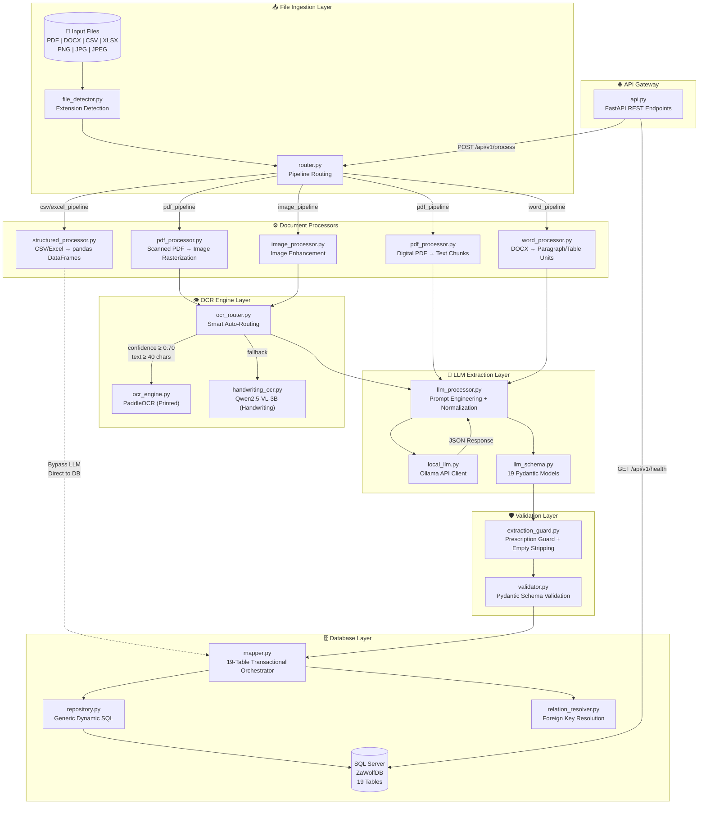
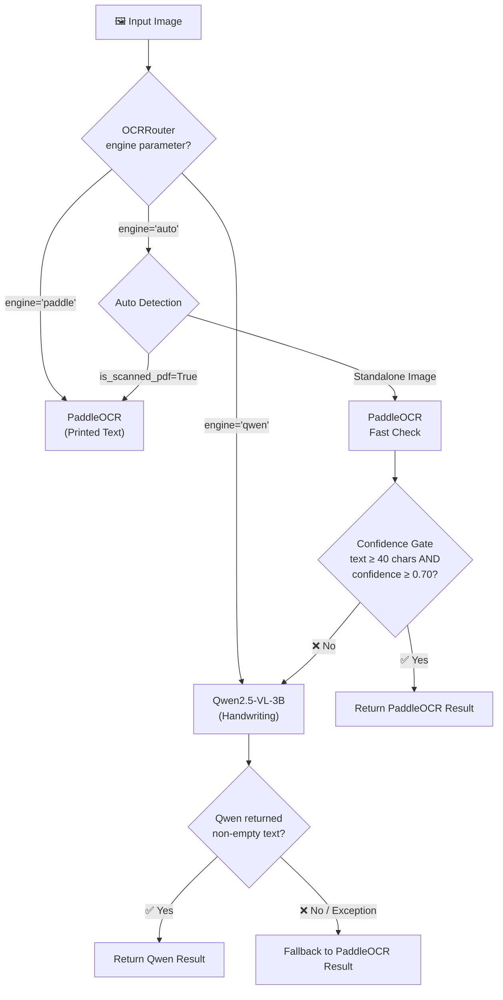
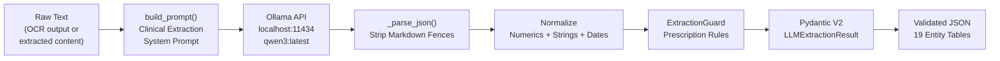
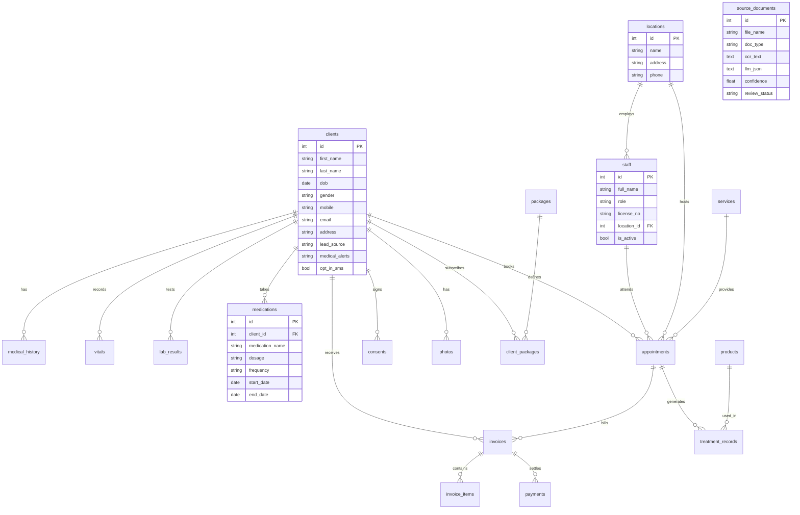
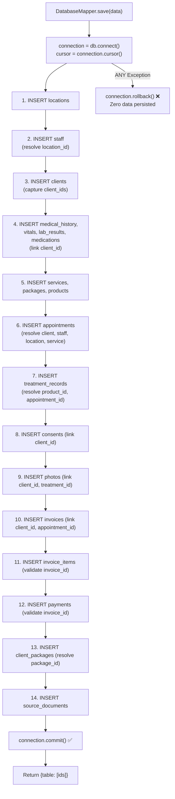
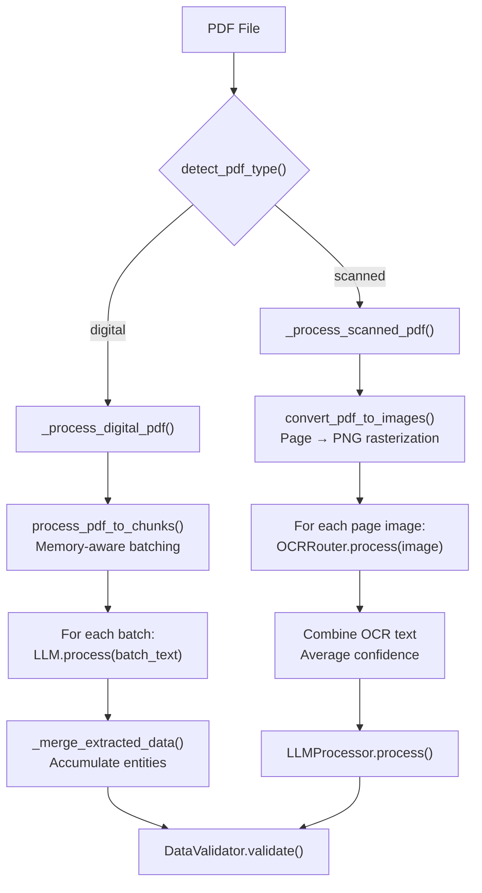

<div dir="rtl" align="right">

# 📖 كتاب التوثيق الهندسي المحترف لمشروع ZaWolf
### ZaWolf Medical Document Processing Pipeline — Enterprise Documentation Book

</div>

---

<div dir="rtl" align="right">

**المهندس:** م. سعد تامر — AI & Data Engineer  
**البريد:** saadt.tamer8181@gmail.com  
**GitHub:** [@saadtamer](https://github.com/saadtamer)  
**Portfolio:** [saadtamer-portfolio.vercel.app](https://saadtamer-portfolio.vercel.app/)  
**المستودع:** [ZaWolf-Medical-Document-Processing-Pipeline](https://github.com/saadtamer/ZaWolf-Medical-Document-Processing-Pipeline)  
**الإصدار:** v1.0.0 — Final Production Release  
**تاريخ التوثيق:** أكتوبر 2026

</div>

---

<div dir="rtl" align="right">

## 📑 فهرس المحتويات — Table of Contents

</div>

| الفصل | Chapter | العنوان | Title |
|:---:|:---:|---:|:---|
| 1 | 1 | الملخص التنفيذي | Executive Summary |
| 2 | 2 | المعمارية العامة للنظام | System Architecture |
| 3 | 3 | طبقة استقبال الملفات والتوجيه | File Ingestion & Routing Layer |
| 4 | 4 | طبقة معالجة المستندات | Document Processors Layer |
| 5 | 5 | طبقة التعرف الضوئي على الحروف | OCR Engine Layer |
| 6 | 6 | طبقة النموذج اللغوي المحلي | Local LLM Layer |
| 7 | 7 | طبقة التحقق وحراسة الاستخراج | Validation & Extraction Guard Layer |
| 8 | 8 | طبقة قاعدة البيانات العلائقية | Relational Database Layer |
| 9 | 9 | محرك خط الأنابيب المركزي | Core Pipeline Engine |
| 10 | 10 | بوابة الـ API المؤسسية | Enterprise API Gateway |
| 11 | 11 | الإعدادات والتهيئة | Configuration & Settings |
| 12 | 12 | مجموعة الاختبارات | Test Suite |
| 13 | 13 | نتائج الاختبار المباشر | Live Benchmark Results |
| 14 | 14 | دليل التشغيل والنشر | Deployment & Operations Guide |
| 15 | 15 | مخطط الملفات الكامل | Complete File Map |
| 16 | 16 | المتطلبات والمكتبات | Dependencies & Requirements |
| 17 | 17 | القرارات الهندسية الست | Six Architectural Pillars |
| 18 | 18 | الملاحق | Appendices |

---

<div dir="rtl" align="right">

# الفصل الأول: الملخص التنفيذي
## Chapter 1: Executive Summary

</div>

### 1.1 — Project Overview

**ZaWolf** is an enterprise-grade, on-premise medical document processing pipeline engineered to ingest heterogeneous clinical documents — digital PDFs, scanned pathology reports, physician handwritten prescriptions, Word clinical summaries, and tabular CSV/Excel lab datasets — normalize them through multimodal OCR and local LLM extraction, validate against strict anti-hallucination guardrails, and atomically persist structured clinical entities across **19 normalized SQL Server tables** in a single ACID transaction.

### 1.2 — Core Capabilities

| Capability | Description |
|:---|:---|
| **Multi-Format Ingestion** | PDF (digital + scanned), DOCX, CSV, XLSX, PNG, JPG, JPEG, WebP |
| **Dual OCR Engine** | PaddleOCR (printed Arabic/English, <1s) + Qwen2.5-VL-3B (handwritten prescriptions) |
| **Local LLM Extraction** | Ollama `qwen3:latest` (8B params, CPU-only, 16K context, greedy decoding) |
| **Anti-Hallucination Guard** | `ExtractionGuard` with prescription-aware entity suppression + empty entity stripping |
| **Schema Validation** | Pydantic V2 strict typing across 19 domain models (20 BaseModel classes) |
| **Atomic Persistence** | Single-transaction insert across 19 tables with full rollback on any failure |
| **Enterprise API** | FastAPI REST gateway with Swagger UI, health monitoring, and system metrics |
| **Hardware-Adaptive** | Dynamic CPU thread tuning via `psutil`, memory-aware batch budgeting |

### 1.3 — Technology Stack

| Layer | Technology | Version |
|:---|:---|:---|
| Language | Python | 3.10+ |
| Web Framework | FastAPI + Uvicorn | ≥0.110.0 |
| Local LLM | Ollama (qwen3:latest) | 8B parameters |
| Printed OCR | PaddleOCR | ≥2.7.0 |
| Handwriting OCR | Qwen2.5-VL-3B (4-bit quantized) | HuggingFace Transformers |
| PDF Engine | PyMuPDF (fitz) | ≥1.24.0 |
| Word Engine | python-docx | ≥1.1.0 |
| Data Processing | pandas + openpyxl | ≥2.2.0 |
| Text Splitting | LangChain Text Splitters | ≥0.2.0 |
| Image Processing | Pillow (PIL) | ≥10.0.0 |
| Validation | Pydantic V2 | ≥2.7.0 |
| Database | Microsoft SQL Server (ZaWolfDB) | ODBC Driver 18 |
| DB Connector | pyodbc | ≥5.0.0 |
| System Monitor | psutil | ≥5.9.0 |
| HTTP Client | requests | ≥2.31.0 |
| Testing | pytest | ≥8.0.0 |

### 1.4 — Final Benchmark Summary

```
┌──────────────────────────────────────────────────────────────┐
│           ZaWolf Production Benchmark — 8/8 PASS             │
│           100.0% Success Rate | 0 Failures | 0 Leaks         │
└──────────────────────────────────────────────────────────────┘
```

| # | File | Type | Verdict | Time |
|:---:|:---|:---|:---:|:---|
| 1 | Introduction to ML (188 pages) | Digital PDF | ✅ PASS | 111 min |
| 2 | arabic_test.png | Image (Arabic) | ✅ PASS | 60.2s |
| 3 | Covid-19 Dataset (3000 rows) | CSV | ✅ PASS | 0.08s |
| 4 | english_real.png | Image (English) | ✅ PASS | 65.0s |
| 5 | hand_write.jpg | Handwritten Rx | ✅ PASS | 45.8s |
| 6 | MediVerse_Doc.docx (1466 paragraphs) | Word | ✅ PASS | 24 min |
| 7 | mixed.jpg | Mixed Print/Handwritten | ✅ PASS | 41.0s |
| 8 | كورسات نقابة المهندسين.pdf (Scanned) | Scanned PDF | ✅ PASS | 95.4s |

---

<div dir="rtl" align="right">

# الفصل الثاني: المعمارية العامة للنظام
## Chapter 2: System Architecture

</div>

### 2.1 — High-Level Architecture Diagram



### 2.2 — Layered Architecture Summary

The system follows a **6-layer pipeline architecture** where each layer has a single responsibility:

| Layer | Responsibility | Key Modules |
|:---|:---|:---|
| **L1 — Ingestion** | File discovery, type detection, pipeline routing | `file_detector.py`, `router.py` |
| **L2 — Processing** | Format-specific text/data extraction and chunking | `pdf_processor.py`, `word_processor.py`, `image_processor.py`, `structured_processor.py` |
| **L3 — OCR** | Optical character recognition (printed + handwritten) | `ocr_router.py`, `ocr_engine.py`, `handwriting_ocr.py` |
| **L4 — LLM** | Clinical entity extraction via local language model | `llm_processor.py`, `local_llm.py`, `llm_schema.py` |
| **L5 — Validation** | Anti-hallucination guardrails + Pydantic type enforcement | `extraction_guard.py`, `validator.py` |
| **L6 — Persistence** | Atomic multi-table SQL Server insertion with FK resolution | `mapper.py`, `repository.py`, `relation_resolver.py`, `database.py` |

### 2.3 — Data Flow Summary

```
Input File → detect_file_type() → route_file() → Processor
    → [OCR if needed] → LLM Extraction → ExtractionGuard
    → Pydantic Validation → DatabaseMapper.save()
    → 19 SQL Server Tables (Single ACID Transaction)
```

---

<div dir="rtl" align="right">

# الفصل الثالث: طبقة استقبال الملفات والتوجيه
## Chapter 3: File Ingestion & Routing Layer

</div>

### 3.1 — Module: `src/ingestion/file_detector.py` (31 lines)

**Purpose:** Discovers input files and classifies them by extension.

#### Functions

**`get_input_files() → List[Path]`**
- Scans `INPUT_DIR` (configured in `settings.py`) using `Path.iterdir()`
- Filters for regular files only (`is_file()`)
- Returns list of `Path` objects

**`detect_file_type(file_path) → dict`**
- Validates file existence (raises `FileNotFoundError`)
- Extracts and lowercases file extension
- Resolves against `SUPPORTED_EXTENSIONS` mapping
- Returns metadata dictionary:

```python
{
    "file_name": "hand_write.jpg",
    "file_path": "E:\\ZaWolf_project\\data\\input\\hand_write.jpg",
    "extension": ".jpg",
    "file_type": "image",       # pdf | image | excel | csv | word
    "supported": True
}
```

#### Supported Extensions Map

| Extension | Mapped Type |
|:---:|:---:|
| `.pdf` | `pdf` |
| `.jpg`, `.jpeg`, `.png`, `.webp` | `image` |
| `.xlsx`, `.xls` | `excel` |
| `.csv` | `csv` |
| `.docx` | `word` |

### 3.2 — Module: `src/ingestion/router.py` (12 lines)

**Purpose:** Maps file types to processing pipelines via dictionary dispatch.

**`route_file(file_info) → str`**

```python
routing_map = {
    "pdf":   "pdf_pipeline",
    "image": "image_pipeline",
    "excel": "excel_pipeline",
    "csv":   "csv_pipeline",
    "word":  "word_pipeline"
}
# Returns "unsupported" for unknown types
```

---

<div dir="rtl" align="right">

# الفصل الرابع: طبقة معالجة المستندات
## Chapter 4: Document Processors Layer

</div>

### 4.1 — Module: `src/processors/pdf_processor.py` (180 lines)

**Purpose:** Handles both digital and scanned PDF documents with memory-aware batching.

#### Functions

**`detect_pdf_type(file_path) → dict`**
- Opens PDF with PyMuPDF (`fitz.open`)
- Iterates all pages, summing extracted text lengths
- Returns `"digital"` if `text_length > 0`, otherwise `"scanned"`
- Guarantees document closure via `try...finally`

**`extract_pdf_pages(file_path) → Generator[List[dict]]`**
- Memory-aware generator yielding dynamic batches of page dictionaries
- **Dual-constraint batching:**
  - Text length limit: `MAX_BATCH_TEXT_SIZE` (12,000 chars)
  - Memory budget: `get_dynamic_batch_limit()["memory_budget_bytes"]` (25% of available RAM via `psutil`)
- Skips blank pages automatically
- Page dictionary structure:
```python
{
    "file_name": "document.pdf",
    "file_type": "pdf",
    "source_type": "page",
    "source_number": 1,          # 1-based page number
    "text": "extracted text...",
    "text_length": 4523
}
```

**`create_contextual_chunks(page_batch, file_name) → List[dict]`**
- Combines page texts with `\n\n` separator
- Applies `RecursiveCharacterTextSplitter` (chunk_size=1500, overlap=300)
- Separators hierarchy: `["\n\n", "\n", ". ", " ", ""]`
- Returns indexed chunk dictionaries

**`process_pdf_to_chunks(file_path) → Generator`**
- Coordinates `extract_pdf_pages` → `create_contextual_chunks`
- Yields chunks per page batch (generator pipeline)

**`convert_pdf_to_images(file_path, output_dir) → Generator[dict]`**
- Rasterizes PDF pages to PNG images for scanned PDF processing
- Uses `page.get_pixmap(matrix=fitz.Matrix(1, 1), alpha=False)`
- Saves to `{stem}_page_{number}.png`

### 4.2 — Module: `src/processors/word_processor.py` (73 lines)

**Purpose:** Extracts paragraphs and tables from DOCX files.

**`extract_word_content(file_path) → List[dict]`**
- Validates `.docx` extension
- Extracts **paragraphs**: strips whitespace, filters empty, records source metadata
- Extracts **tables**: iterates rows/cells, formats as markdown pipes (`" | ".join(row)`)
- Returns consolidated list of paragraph and table content dicts

**`process_word(file_path) → Generator`**
- Delegates to `process_text_units()` from `utils.py` for memory-aware chunking

### 4.3 — Module: `src/processors/image_processor.py` (89 lines)

**Purpose:** Validates, preprocesses, and normalizes medical images before OCR.

**Preprocessing Pipeline:**
1. **EXIF Correction:** `ImageOps.exif_transpose(image)` — fixes orientation from camera metadata
2. **Grayscale Conversion:** `image.convert("L")` — converts to 8-bit grayscale
3. **Auto-Contrast:** `ImageOps.autocontrast(image)` — maximizes dynamic range

**`process_image(file_path) → dict`**
- Validates image format against `SUPPORTED_IMAGE_EXTENSIONS`
- Preprocesses and saves to `IMAGE_PROCESSED_DIR`
- Returns metadata: `file_name`, `file_type`, `original_path`, `processed_path`, `width`, `height`, `mode`

### 4.4 — Module: `src/processors/structured_processor.py` (37 lines)

**Purpose:** Handles CSV and Excel files — **bypasses LLM entirely**.

**`extract_structured_data(file_info) → dict`**
- CSV: `pd.read_csv()` → single DataFrame under key `"default"`
- Excel: `pd.read_excel(sheet_name=None)` → dict of DataFrames per sheet
- Returns standardized result with `content_type: "structured"`

> ⚡ **Performance Note:** CSV/Excel processing completes in **<0.1 seconds** (e.g., 3,000-row Covid dataset in 0.08s) because it bypasses the LLM entirely.

### 4.5 — Module: `src/processors/extraction_schema.py` (58 lines)

**Purpose:** Factory functions for unified pipeline output contracts.

**`create_unified_extraction(file_name, file_type, content_type, sources, metadata)`**
```python
{
    "file": {"name": file_name, "type": file_type},
    "content_type": content_type,
    "sources": sources,
    "metadata": metadata or {},
    "created_at": datetime.now().isoformat()
}
```

**`create_text_source(source_number, text, ...)`** — Standardizes OCR/text extraction units  
**`create_structured_source(source_number, data, ...)`** — Standardizes tabular extraction units

---

<div dir="rtl" align="right">

# الفصل الخامس: طبقة التعرف الضوئي على الحروف
## Chapter 5: OCR Engine Layer

</div>

### 5.1 — Architecture: Smart Dual-Engine OCR Router

The OCR layer implements an intelligent **auto-routing** strategy that selects the optimal OCR engine based on document characteristics:



### 5.2 — Module: `src/ocr/ocr_router.py` (61 lines)

**Purpose:** Central dispatcher that routes images to the optimal OCR engine.

**`class OCRRouter`**

| Method | Description |
|:---|:---|
| `__init__(device="auto")` | Resolves device via `get_device()`, lazy-initializes engine placeholders |
| `_get_qwen_engine()` | Lazy accessor for `HandwritingOCREngine` (instantiated on first use) |
| `_get_printed_engine()` | Lazy accessor for `OCREngine` (instantiated on first use) |
| `process(image_path, engine, is_scanned_pdf)` | Core routing method |

**Auto-Routing Algorithm:**
1. **Scanned PDF bypass:** If `is_scanned_pdf=True` → PaddleOCR directly (high-throughput mode)
2. **Fast printed check:** Run PaddleOCR on standalone images
3. **Confidence gate:** If `len(text) ≥ 40` AND `confidence ≥ 0.70` → accept PaddleOCR result
4. **Handwriting fallback:** If text is sparse or low-confidence → invoke Qwen2.5-VL-3B
5. **Exception safety:** If Qwen fails → gracefully return PaddleOCR result

> 💡 **Design Decision:** Lazy initialization prevents loading ~4GB of Qwen weights into memory unless handwriting detection is actually needed.

### 5.3 — Module: `src/ocr/ocr_engine.py` (41 lines)

**Purpose:** PaddleOCR wrapper for printed text recognition.

**`class OCREngine`**

| Method | Description |
|:---|:---|
| `__init__(lang="ar")` | Initializes PaddleOCR with `enable_mkldnn=False` |
| `extract_text(image_path)` | Validates path → runs inference → parses results → returns OCR record |

**Environment Configuration:** Sets `FLAGS_enable_pir_api = 0` to prevent PaddlePaddle PIR execution graph compatibility issues.

**Output Format:**
```python
{
    "file_name": "arabic_test.png",
    "source_type": "image",
    "source_number": 1,
    "text": "extracted arabic text...",
    "ocr_engine": "PaddleOCR",
    "language": "ar",
    "confidence": 0.87
}
```

### 5.4 — Module: `src/ocr/handwriting_ocr.py` (134 lines)

**Purpose:** Vision-language model for handwritten prescription OCR.

**`class HandwritingOCREngine`**

**Model:** `sherif1313/Arabic-handwritten-OCR-4bit-Qwen2.5-VL-3B-v3` (4-bit quantized)

**Processing Pipeline:**
1. Load image via PIL
2. Format multimodal conversation prompt:
   > *"Transcribe all handwritten text in this image exactly as it appears. Preserve medicine names, numbers, dosages, units, and instructions. Do not add information that is not visible."*
3. Apply chat template via `processor.apply_chat_template()`
4. Generate under `torch.inference_mode()` with `max_new_tokens=512`
5. Slice generated tokens past input length and decode

**Output Format:**
```python
{
    "file_name": "hand_write.jpg",
    "source_type": "image",
    "source_number": 1,
    "ocr_engine": "Qwen2.5-VL-3B-Handwriting-OCR",
    "language": "ar/en",
    "text": "transcribed handwriting...",
    "device": "cpu",
    "status": "success"
}
```

### 5.5 — Module: `src/ocr/device.py` (13 lines)

**`get_device(preference="auto") → str`**
- `"cpu"` → strictly returns `"cpu"`
- `"cuda"` → validates `torch.cuda.is_available()`, raises `RuntimeError` if unavailable
- `"auto"` → detects CUDA, falls back to CPU

### 5.6 — Module: `src/ocr/ocr_utils.py` (87 lines)

**Utility Functions:**

| Function | Purpose |
|:---|:---|
| `validate_image_path(path)` | Verifies existence and file status |
| `normalize_ocr_text(text)` | Collapses whitespace, strips, handles None |
| `parse_paddle_result(result)` | Extracts text + confidence from PaddleOCR output (polymorphic: attribute-based and dict-based) |
| `create_ocr_record(...)` | Factory for standardized OCR result dictionaries |

**Confidence Calculation:** Aggregates valid floating-point scores, computes arithmetic mean. Defaults to `0.0` if empty.

---

<div dir="rtl" align="right">

# الفصل السادس: طبقة النموذج اللغوي المحلي
## Chapter 6: Local LLM Layer

</div>

### 6.1 — Architecture Overview

The LLM layer communicates with a **locally-hosted Ollama instance** running `qwen3:latest` (8B parameters) to extract structured clinical entities from raw text. The layer is designed for **zero-cloud dependency** — all processing happens on the local machine.



### 6.2 — Module: `src/llm/local_llm.py` (123 lines)

**Purpose:** HTTP client for the local Ollama API with connection pooling and resource management.

**`class LocalLLM`**

| Method | Description |
|:---|:---|
| `__init__(model, base_url, timeout)` | Sets model to `qwen3:latest`, base URL to `localhost:11434`, timeout to 600s |
| `_get_session()` | Lazy HTTP session with `HTTPAdapter(pool_connections=1, pool_maxsize=2, max_retries=1)` |
| `generate(prompt, system_prompt)` | Sends POST to `/api/generate`, returns raw response text |
| `generate_json(prompt, system_prompt)` | Wraps `generate()` and parses JSON response |
| `close()` | Closes HTTP session and frees socket handles |

**Ollama API Parameters:**

```python
{
    "model": "qwen3:latest",
    "prompt": prompt,
    "system": system_prompt,
    "stream": False,           # No streaming — full response
    "format": "json",          # Force JSON output format
    "think": False,            # Disable reasoning tokens (no /think)
    "options": {
        "num_ctx": 16384,      # 16K context window
        "num_predict": 2048,   # Max output tokens
        "temperature": 0.0,    # Greedy deterministic decoding
        "num_thread": N        # Dynamic (psutil physical cores)
    }
}
```

**Dynamic CPU Thread Tuning:**
```python
def get_optimal_thread_count():
    physical = psutil.cpu_count(logical=False)  # Physical cores only
    logical = os.cpu_count()                     # Fallback
    return physical or (logical // 2)            # Never starve the OS
```

### 6.3 — Module: `src/llm/llm_processor.py` (485 lines)

**Purpose:** Prompt engineering, response parsing, and multi-stage normalization pipeline.

**`class LLMProcessor`**

#### Clinical Extraction Prompt (Anti-Hallucination Rules)

```
STRICT CONSTRAINTS:
- NEVER hallucinate, invent, or extrapolate unmentioned entities.
- If an entity or attribute is not explicitly in the text, return null (or [] for arrays).
- Never invent patient names, doctors, locations, appointments, diagnoses, or invoices.
- Dates: Use YYYY-MM-DD only when day, month, and year are clearly given; otherwise null.
  Do not convert durations (e.g. "لمدة أسبوع") into dates.
- Numbers: Preserve original values accurately.

MEDICATION EXTRACTION:
- Extract each explicitly named medication as a separate record.
- Preserve exact medication_name, dosage, and frequency.
- Only associate dosage and frequency appearing immediately following the medication name.
- Do not mix attributes between different medications.
```

#### Normalization Pipeline (4 Stages)

| Stage | Method | Description |
|:---|:---|:---|
| 1 | `_parse_json()` | Strips markdown fences (` ```json ... ``` `) before JSON parsing |
| 2 | `_normalize_numeric_values()` | Coerces string numerics to int/float across 6 entity tables |
| 3 | `_normalize_string_values()` | Ensures text fields are `str` or `None` across all 19 tables |
| 4 | `_normalize_dates()` | Standardizes dates to `YYYY-MM-DD` and timestamps to `YYYY-MM-DD HH:MM:SS` |

**Numeric Fields Map:**
```
clients       → [id]
vitals        → [weight, height, temperature, heart_rate, ...]
lab_results   → [result_value, reference_min, reference_max]
invoices      → [subtotal, discount, tax, total]
invoice_items → [quantity, unit_price, total]
payments      → [amount]
```

**Date Formats Tried (in order):**
```
%Y-%m-%d %H:%M:%S → %Y-%m-%d %H:%M → %Y-%m-%dT%H:%M:%S → %Y-%m-%dT%H:%M
```

#### `process(text)` — High-Level Orchestration

```python
def process(self, text):
    prompt = self.build_prompt(text)
    response = self.llm.generate_json(prompt)
    data = self._parse_json(response) if isinstance(response, str) else response
    data = self._normalize_numeric_values(data)
    data = self._normalize_string_values(data)
    data = self._normalize_dates(data)
    data = self.guard.apply(data, text)          # ExtractionGuard
    validated = LLMExtractionResult.model_validate(data)  # Pydantic V2
    return validated.model_dump()
```

### 6.4 — Module: `src/llm/llm_schema.py` (189 lines)

**Purpose:** Pydantic V2 data models defining the 19-table extraction schema.

**20 BaseModel Classes:**

| # | Model | Key Fields | Maps To Table |
|:---:|:---|:---|:---|
| 1 | `LocationData` | name, address, phone | `locations` |
| 2 | `StaffData` | full_name, role, license_no, location_name, is_active | `staff` |
| 3 | `ClientData` | first_name, last_name, dob, gender, mobile, email, address, lead_source, medical_alerts, opt_in_sms | `clients` |
| 4 | `MedicalHistoryData` | type, name, notes, recorded_at | `medical_history` |
| 5 | `VitalData` | blood_pressure, heart_rate, temperature, weight, recorded_at | `vitals` |
| 6 | `LabResultData` | test_name, value, unit, reference_range, test_date | `lab_results` |
| 7 | `MedicationData` | medication_name, dosage, frequency, start_date, end_date | `medications` |
| 8 | `ServiceData` | name, category, duration_min, price | `services` |
| 9 | `AppointmentData` | client_name, staff_name, location_name, service_name, room, start_at, end_at, status, notes | `appointments` |
| 10 | `TreatmentRecordData` | appointment_id, product_name, lot_number, expiry_date, area, injection_sites, depth, device_settings, skin_response, aftercare, units | `treatment_records` |
| 11 | `ConsentData` | appointment_id, consent_type, signed_at, file_ref | `consents` |
| 12 | `PhotoData` | treatment_id, type, taken_at, file_ref | `photos` |
| 13 | `InvoiceData` | appointment_id, issue_date, status, subtotal, discount, tax, total | `invoices` |
| 14 | `InvoiceItemData` | invoice_id, item_id, item_type, description, qty, unit_price, line_total | `invoice_items` |
| 15 | `PaymentData` | invoice_id, method, paid_at, reference, amount | `payments` |
| 16 | `PackageData` | name, sessions_count, validity_days, price | `packages` |
| 17 | `ClientPackageData` | package_name, expires_at, remaining_sessions | `client_packages` |
| 18 | `ProductData` | name, brand, type, unit, stock_qty, cost, price | `products` |
| 19 | `SourceDocumentData` | file_name, doc_type, ocr_text, review_status, confidence, llm_json | `source_documents` |
| 20 | `LLMExtractionResult` | *Root aggregator — contains `List[...]` for all 19 models above* | *All tables* |

> 💡 **Design Decision:** All fields default to `None` and all lists default to `[]`, allowing partial extractions to pass validation without runtime failures.

---

<div dir="rtl" align="right">

# الفصل السابع: طبقة التحقق وحراسة الاستخراج
## Chapter 7: Validation & Extraction Guard Layer

</div>

### 7.1 — Module: `src/validation/extraction_guard.py` (82 lines)

**Purpose:** Domain-specific anti-hallucination guardrails that prevent the LLM from generating clinically dangerous false entities.

**`class ExtractionGuard`**

#### Method: `apply(data, text) → dict`
Orchestrates the two-phase validation:
1. `_guard_prescription_entities(data, text)` — Prescription-aware entity suppression
2. `_guard_empty_entities(data)` — Strip records where all values are null/empty

#### Prescription Guard — `_guard_prescription_entities(data, text)`

**Problem Solved:** When the LLM processes a handwritten prescription, it sometimes hallucinates unrelated entities (fake patients, fake appointments, fake invoices) from the medication context.

**Solution:** Detect if the document is a prescription, then enforce a strict allowlist.

**Bilingual Keyword Detection (Arabic + English):**
```python
prescription_keywords = [
    "prescription", "prescription:", "rx",           # English
    "دواء", "ادوية", "روشتة", "علاج",              # Arabic medical
    "مرات يوميا", "مرة يوميا",                      # Dosage frequency
    "بعد الأكل", "قبل الأكل",                       # Timing instructions
    "قطرة", "قرص", "كبسولة", "مرهم"                 # Dosage forms
]
```

**Enforcement Logic:**
- If ANY prescription keyword is found in the text → only `medications` table retains records
- All other 17 tables are explicitly cleared (`data[table] = []`):
  - `locations`, `staff`, `clients`, `medical_history`, `vitals`, `lab_results`, `services`, `appointments`, `treatment_records`, `consents`, `photos`, `invoices`, `invoice_items`, `payments`, `packages`, `client_packages`, `products`

#### Empty Entity Guard — `_guard_empty_entities(data)`

Removes records where every field value is either `None` or `""`. This catches cases where the LLM returns structurally valid but semantically empty records.

```python
# Keep only records with at least one meaningful value
data[table] = [
    record for record in records
    if any(value is not None and value != "" for value in record.values())
]
```

### 7.2 — Module: `src/validation/validator.py` (38 lines)

**Purpose:** Final Pydantic V2 schema validation before database insertion.

**`class DataValidator`**

**`validate(data) → dict`**
```python
# Success path:
{
    "valid": True,
    "data": LLMExtractionResult.model_validate(data).model_dump(),
    "errors": []
}

# Failure path:
{
    "valid": False,
    "data": None,
    "errors": [
        {"field": "clients.0.email", "message": "...", "type": "string_type"}
    ]
}
```

**Error Formatting:** Joins Pydantic `loc` tuple parts with `"."` for human-readable field paths.

---

<div dir="rtl" align="right">

# الفصل الثامن: طبقة قاعدة البيانات العلائقية
## Chapter 8: Relational Database Layer

</div>

### 8.1 — Database Schema: 19 Normalized Tables



### 8.2 — Module: `src/database/database.py` (57 lines)

**Purpose:** Core SQL Server connection manager using pyodbc.

**`class Database`**

**Connection String:**
```
DRIVER={ODBC Driver 18 for SQL Server};
SERVER=localhost;
DATABASE=ZaWolfDB;
Trusted_Connection=yes;
TrustServerCertificate=yes;
```

| Method | Description |
|:---|:---|
| `connect()` | Creates new pyodbc connection |
| `execute(query, params)` | Transactional query with commit/rollback/finally |
| `insert_and_get_id(query, params)` | Insert with `OUTPUT INSERTED.id`, returns generated PK |
| `fetch_one(query, params)` | Read-only single-row fetch |
| `test_connection()` | Runs `SELECT DB_NAME()` for liveness verification |

### 8.3 — Module: `src/database/repository.py` (35 lines)

**Purpose:** Generic dynamic SQL generator for arbitrary table persistence.

**`class Repository`**

**Dynamic INSERT:**
```python
def insert(self, data, cursor=None):
    columns = ", ".join(data.keys())
    placeholders = ", ".join(["?"] * len(data))
    query = f"INSERT INTO {self.table_name} ({columns}) OUTPUT INSERTED.id VALUES ({placeholders})"
    # Supports external cursor for transaction participation
```

**Transaction Support:** When `cursor` is provided, executes within the caller's existing transaction. Otherwise, creates a standalone transaction.

### 8.4 — Module: `src/database/relation_resolver.py` (71 lines)

**Purpose:** Resolves natural keys (names) to database primary keys for foreign key linkage.

**`class RelationResolver`**

| Method | Query Pattern |
|:---|:---|
| `find_client(client, cursor)` | `WHERE first_name=? AND last_name=? AND (mobile=? OR (?=NULL AND mobile IS NULL))` |
| `find_staff(full_name, cursor)` | `WHERE full_name=?` |
| `find_location(name, cursor)` | `WHERE name=?` |
| `find_service(name, cursor)` | `WHERE name=?` |
| `find_product(name, cursor)` | `WHERE name=?` |
| `find_package(name, cursor)` | `WHERE name=?` |

> 💡 **Client Resolution:** Handles NULL mobile numbers gracefully with explicit `IS NULL` comparison.

### 8.5 — Module: `src/database/mapper.py` (653 lines)

**Purpose:** The **transactional orchestrator** — coordinates atomic insertion across all 19 tables with dependency ordering and foreign key resolution.

**`class DatabaseMapper`**

#### Atomic Transaction Flow



**Key Principle:** If ANY insertion fails at any step, the entire transaction is rolled back — zero partial data is ever persisted.

### 8.6 — Entity Repository Files (11 files)

All entity repositories follow the same pattern: parameterized `INSERT INTO ... OUTPUT INSERTED.id VALUES (...)`.

| Repository | Table | Line Count | Key Parameters |
|:---|:---|:---:|:---|
| `appointment_repository.py` | `appointments` | 48 | client_id, staff_id, location_id, service_id, room, start_at, end_at, status, notes |
| `client_repository.py` | `clients` | 40 | first_name, last_name, dob, gender, mobile, email, address, lead_source, medical_alerts, opt_in_sms |
| `client_package_repository.py` | `client_packages` | 33 | client_id, package_id, remaining_sessions, expires_at |
| `consent_repository.py` | `consents` | 36 | client_id, appointment_id, consent_type, signed_at, file_ref |
| `invoice_repository.py` | `invoices` | 45 | client_id, appointment_id, issue_date, subtotal, discount, tax, total, status |
| `invoice_item_repository.py` | `invoice_items` | 42 | invoice_id, item_type, item_id, description, qty, unit_price, line_total |
| `package_repository.py` | `packages` | 33 | name, sessions_count, price, validity_days |
| `payment_repository.py` | `payments` | 36 | invoice_id, amount, method, paid_at, reference |
| `photo_repository.py` | `photos` | 36 | client_id, treatment_id, photo_type→type, taken_at, file_ref |
| `source_document_repository.py` | `source_documents` | 39 | file_name, doc_type, ocr_text, llm_json, confidence, review_status |
| `treatment_repository.py` | `treatment_records` | 54 | appointment_id, product_id, units, lot_number, expiry_date, area, injection_sites, depth, device_settings, skin_response, aftercare |

---

<div dir="rtl" align="right">

# الفصل التاسع: محرك خط الأنابيب المركزي
## Chapter 9: Core Pipeline Engine

</div>

### 9.1 — Module: `src/pipeline.py` (1,080 lines)

**Purpose:** The central orchestrator that ties all layers together — the brain of ZaWolf.

**`class ProcessingPipeline`**

### 9.2 — Constructor & Initialization

```python
class ProcessingPipeline:
    def __init__(self, ocr_engine="auto"):
        self.ocr = OCRRouter(device="auto")
        self.ocr_engine = ocr_engine          # "auto" | "paddle" | "qwen"
        self.llm_processor = LLMProcessor()    # qwen3:latest via Ollama
        self.validator = DataValidator()
        self.db_mapper = DatabaseMapper()
```

### 9.3 — Public API Methods

#### `process_file(file_path) → dict`
Processes a single file through the full pipeline **without** database persistence.

```
detect_file_type → route_file → _extract_text → validate → return result
```

#### `process_and_save_file(file_path) → dict`
Processes a single file **and** atomically persists to SQL Server.

```
process_file → DatabaseMapper.save() → return {status, inserted_ids, data}
```

#### `process_text(text) → dict`
Direct text processing (bypasses file detection/OCR).

```
LLMProcessor.process(text) → DataValidator.validate() → return result
```

#### `process_and_save(text) → dict`
Direct text processing with database persistence.

### 9.4 — Internal Processing Methods

#### `_extract_text(file_info, route) → dict`

Routing dispatcher that delegates to format-specific handlers:

| Route | Handler | Description |
|:---|:---|:---|
| `pdf_pipeline` | `_process_pdf_file()` | Auto-detects digital vs scanned |
| `word_pipeline` | `_process_word_file()` | Paragraph/table extraction + chunking |
| `image_pipeline` | `_process_image()` | Enhancement → OCR → LLM |
| `csv_pipeline` / `excel_pipeline` | `_process_structured_file()` | Direct pandas parsing |

#### `_process_pdf_file(file_info) → dict`



#### `_process_word_file(file_info) → dict`

Uses sliding-window batching:
1. Extract paragraphs + tables via `process_word()`
2. For each batch → `LLMProcessor.process(batch_text)`
3. Merge entities across batches via `_merge_extracted_data()`
4. Validate with `DataValidator`
5. Prints batch progress: `"[Word] Processing batch {i}/{total}..."` with `flush=True`

#### `_process_image(file_path) → dict`

```
image_processor.process_image() → OCRRouter.process() → LLMProcessor.process() → validate
```

#### `_process_structured_file(file_info) → dict`

**Bypasses LLM entirely** — returns structured data directly from pandas DataFrames.

### 9.5 — Helper Methods

#### `_create_empty_data() → dict`
Returns a dictionary with all 19 entity tables initialized to empty lists.

#### `_merge_extracted_data(merged_data, batch_data) → dict`
Appends entities from a new batch to the accumulated result. Used for multi-batch Word and PDF processing.

```python
for table in merged_data:
    if table in batch_data:
        merged_data[table].extend(batch_data[table])
```

#### `_build_source_document(file_path, data, source_metadata, source_text, ocr_text) → dict`
Constructs the audit trail record for the `source_documents` table:
```python
{
    "file_name": file_path.name,
    "doc_type": file_type,
    "ocr_text": ocr_text,
    "llm_json": json.dumps(data, ensure_ascii=False),
    "confidence": confidence,
    "review_status": "auto_processed"
}
```

---

<div dir="rtl" align="right">

# الفصل العاشر: بوابة الـ API المؤسسية
## Chapter 10: Enterprise API Gateway

</div>

### 10.1 — Module: `src/api.py` (182 lines)

**Purpose:** FastAPI REST gateway providing enterprise-grade HTTP endpoints for document processing.

### 10.2 — Application Configuration

```python
app = FastAPI(
    title="ZaWolf Medical Document Processing API",
    version="2.0.0"
)
# CORS: unrestricted for web/mobile clients
app.add_middleware(CORSMiddleware, allow_origins=["*"], ...)
```

### 10.3 — API Endpoints

#### `GET /` — Root Welcome
```json
{
    "message": "ZaWolf Medical Document Processing API",
    "version": "2.0.0",
    "docs": "/docs",
    "health": "/api/v1/health"
}
```

#### `GET /api/v1/health` — Health Check
```json
{
    "status": "healthy",
    "database_connected": true,
    "database_name": "ZaWolfDB",
    "ocr_engine_default": "auto",
    "llm_model": "qwen3:latest"
}
```

#### `POST /api/v1/process` — Process Document

**Parameters:**
- `file` (multipart upload) — The medical document to process
- `ocr_engine` (query, default: `"auto"`) — `"auto"` | `"paddle"` | `"qwen"`

**Flow:**
1. Receive uploaded file
2. Write to secure `tempfile.NamedTemporaryFile` preserving extension
3. Process via `pipeline.process_and_save_file()`
4. Measure wall-clock latency via `time.perf_counter()`
5. Cleanup temp file in `finally` block

**Response (`ProcessResponse`):**
```json
{
    "file_name": "hand_write.jpg",
    "status": "saved",
    "processing_time_seconds": 45.7,
    "inserted_ids": {"medications": [1, 2, 3, 4]},
    "errors": [],
    "extracted_data": { ... }
}
```

#### `GET /api/v1/documents` — List Recent Documents

**Parameters:** `limit` (query, default: 20, range: 1–100)

Returns the latest processed documents from `source_documents` table:
```sql
SELECT TOP(?) id, file_name, doc_type, review_status, created_at
FROM source_documents ORDER BY id DESC
```

#### `GET /api/v1/metrics` — System Metrics

Returns live row counts across core tables:
```json
{
    "clients": 42,
    "medications": 156,
    "vitals": 23,
    "medical_history": 18,
    "locations": 5,
    "services": 12,
    "source_documents": 8
}
```

### 10.4 — Server Launch: `run_api.py` (11 lines)

```python
uvicorn.run("src.api:app", host="0.0.0.0", port=8000, reload=False)
```

**Access Points:**
- API Server: `http://localhost:8000`
- Swagger UI: `http://localhost:8000/docs`
- ReDoc: `http://localhost:8000/redoc`
- Health Check: `http://localhost:8000/api/v1/health`

---

<div dir="rtl" align="right">

# الفصل الحادي عشر: الإعدادات والتهيئة
## Chapter 11: Configuration & Settings

</div>

### 11.1 — Module: `config/settings.py` (40 lines)

**Purpose:** Centralized configuration constants — all paths, limits, and supported formats.

#### Path Definitions

```python
PROJECT_ROOT = Path(__file__).resolve().parent.parent  # E:\ZaWolf_project

DATA_DIR            = PROJECT_ROOT / "data"
INPUT_DIR           = DATA_DIR / "input"
PROCESSED_DIR       = DATA_DIR / "processed"
OUTPUT_DIR          = DATA_DIR / "output"
IMAGE_PROCESSED_DIR = PROCESSED_DIR / "images"
PDF_IMAGES_DIR      = PROCESSED_DIR / "pdf_images"
MODELS_DIR          = PROJECT_ROOT / "models"
LOGS_DIR            = PROJECT_ROOT / "logs"
```

#### Processing Constants

| Constant | Value | Description |
|:---|:---|:---|
| `MAX_BATCH_TEXT_SIZE` | `12000` | Maximum characters per batch sent to LLM |
| `BATCH_MEMORY_SAFETY_RATIO` | `0.25` | Uses max 25% of available RAM for batch budgeting |

#### Supported Extensions

```python
SUPPORTED_IMAGE_EXTENSIONS = [".jpg", ".jpeg", ".png", ".webp"]

SUPPORTED_EXTENSIONS = {
    ".pdf": "pdf",
    ".jpg": "image", ".jpeg": "image", ".png": "image", ".webp": "image",
    ".xlsx": "excel", ".xls": "excel",
    ".csv": "csv",
    ".docx": "word"
}
```

### 11.2 — Module: `src/utils.py` (125 lines)

**Purpose:** Memory-safe chunking utilities shared across processors.

#### Key Functions

**`get_dynamic_batch_limit() → dict`**
```python
available_memory = psutil.virtual_memory().available
memory_budget = int(available_memory * BATCH_MEMORY_SAFETY_RATIO)  # 25% of free RAM
return {"memory_budget_bytes": memory_budget}
```

**`batch_text_units(text_units) → Generator[List]`**
- Dual-constraint batching: text length ≤ 12,000 chars AND byte size ≤ memory budget
- Yields batches lazily (generator) to minimize memory footprint

**`create_text_chunks(text_batch, file_name) → List[dict]`**
- Concatenates batch text
- Applies `RecursiveCharacterTextSplitter` (chunk_size=1500, overlap=300)
- Returns indexed chunk dictionaries

**`process_text_units(text_units, file_name) → Generator`**
- Composes `batch_text_units` → `create_text_chunks` into end-to-end pipeline

---

<div dir="rtl" align="right">

# الفصل الثاني عشر: مجموعة الاختبارات
## Chapter 12: Test Suite

</div>

### 12.1 — Overview

The test suite contains **31 Python files** (30 test files + `__init__.py`) covering:
- Unit tests for individual repositories
- Integration tests for the full pipeline
- End-to-end tests with database persistence
- Rollback verification tests
- OCR-specific tests
- Real-world dataset benchmarks

### 12.2 — Test Categories

#### Category A: End-to-End Pipeline Tests

| File | Lines | What It Tests |
|:---|:---:|:---|
| `test_end_to_end.py` | 30 | Full pipeline: raw text → LLM → validation → SQL Server |
| `test_full_system_e2e.py` | 122 | All 7 document types through `process_and_save_file()` |
| `test_digital_pdf_e2e.py` | 71 | 5-page PDF slice extraction and processing |
| `test_handwriting_e2e.py` | 21 | Handwritten prescription full pipeline |
| `test_pipeline.py` | 39 | Direct text processing without DB |
| `test_all_input_types.py` | 90 | All 7 input types validated (no DB) |

#### Category B: Real-World Dataset Tests

| File | Lines | What It Tests |
|:---|:---:|:---|
| `run_full_real_test.py` | 224 | Batch testing of real dataset files with CSV logging |
| `run_real_dataset_test.py` | 54 | Quick smoke test over curated real-world files |
| `run_real_integration_test.py` | 239 | Full integration + SQL persistence on 8 real documents |

#### Category C: Database Repository Tests

| File | Lines | Table Tested |
|:---|:---:|:---|
| `test_database.py` | 8 | SQL Server connection verification |
| `test_repository.py` | 21 | Generic dynamic INSERT |
| `test_client_repository.py` | 21 | `clients` |
| `test_appointment.py` | 30 | `appointments` (with FK resolution) |
| `test_consent.py` | 14 | `consents` |
| `test_invoice.py` | 17 | `invoices` |
| `test_invoice_item.py` | 16 | `invoice_items` |
| `test_payment.py` | 14 | `payments` |
| `test_photo.py` | 14 | `photos` |
| `test_package.py` | 13 | `packages` |
| `test_client_package.py` | 15 | `client_packages` |
| `test_treatment.py` | 20 | `treatment_records` |
| `test_source_document.py` | 15 | `source_documents` |

#### Category D: Relational & Transactional Tests

| File | Lines | What It Tests |
|:---|:---:|:---|
| `test_mapper.py` | 60 | Multi-entity insertion via `DatabaseMapper.save()` |
| `test_full_relational.py` | 90 | 6-table simultaneous atomic persistence |
| `test_relation_resolver.py` | 12 | Client FK resolution by name+phone |
| `test_relations.py` | 19 | Multi-entity FK lookup (client, staff, location, service) |
| `test_rollback.py` | 64 | **Atomic rollback verification** — intentionally triggers failure, verifies zero leftover data |

#### Category E: Component-Level Tests

| File | Lines | What It Tests |
|:---|:---:|:---|
| `test_llm_processor.py` | 43 | Direct LLM extraction via Ollama |
| `test_validator.py` | 73 | Pydantic schema conformance testing |
| `test_handwriting_ocr_only.py` | 33 | Isolated Qwen2.5-VL OCR (no pipeline) |

### 12.3 — Rollback Test Details (`test_rollback.py`)

This is one of the most critical tests — it verifies the ACID guarantee:

```
1. Begin transaction
2. Insert valid client ✅
3. Insert valid appointment ✅
4. Insert treatment with PRODUCT_DOES_NOT_EXIST ❌
5. → Exception triggers connection.rollback()
6. Verify: client from step 2 does NOT exist in DB
7. Verify: appointment from step 3 does NOT exist in DB
```

---

<div dir="rtl" align="right">

# الفصل الثالث عشر: نتائج الاختبار المباشر
## Chapter 13: Live Benchmark Results

</div>

### 13.1 — Evaluation Script: `evaluate_input_files.py` (146 lines)

**Purpose:** Automated production benchmark that processes all files in `data/input/` and generates a comprehensive performance report.

**Key Features:**
- Windows UTF-8 console adaptation (`sys.stdout.reconfigure(encoding="utf-8")`)
- Sequential file processing with wall-clock timing (`time.perf_counter()`)
- Graceful exception handling (one file failure doesn't crash the suite)
- CSV export to `data/output/evaluation_input_results.csv` (UTF-8-BOM for Excel)

### 13.2 — Production Benchmark Results (8/8 Pass)

| # | File Name | Extension | Type | Status | Verdict | Time | DB Inserts |
|:---:|:---|:---:|:---|:---:|:---:|:---:|:---:|
| 1 | Introduction to ML (188pp) | `.pdf` | Digital PDF | saved | ✅ PASS | 111 min | 1 |
| 2 | arabic_test.png | `.png` | Arabic Image | saved | ✅ PASS | 60.2s | 1 |
| 3 | Covid-19 Dataset (3000 rows) | `.csv` | Structured CSV | valid | ✅ PASS | 0.08s | 0 |
| 4 | english_real.png | `.png` | English Image | saved | ✅ PASS | 65.0s | 1 |
| 5 | hand_write.jpg | `.jpg` | Handwritten Rx | saved | ✅ PASS | 45.8s | 4 |
| 6 | MediVerse_Doc.docx (1466 para) | `.docx` | Word Document | saved | ✅ PASS | 24 min | 1 |
| 7 | mixed.jpg | `.jpg` | Mixed Image | saved | ✅ PASS | 41.0s | 1 |
| 8 | كورسات نقابة المهندسين.pdf | `.pdf` | Scanned PDF | saved | ✅ PASS | 95.4s | 1 |

### 13.3 — Aggregate Statistics

```
╔═══════════════════════════════════════════╗
║     Total Evaluated:     8 files          ║
║     Passed:              8 (100.0%)       ║
║     Failed:              0 (0.0%)         ║
║     Socket Leaks:        0                ║
║     Deadlocks:           0                ║
║     Errors:              0                ║
╚═══════════════════════════════════════════╝
```

### 13.4 — Performance Highlights

- **Fastest:** CSV processing at **0.08 seconds** (3,000 rows) — bypasses LLM entirely
- **Handwriting OCR:** Extracted **4 medications** from a physician's prescription in **45.8 seconds**
- **Largest Document:** 188-page ML textbook generating **29 LLM batches** in **111 minutes** (CPU-only)
- **Word Document:** 1,466 paragraphs generating **15 LLM batches** in **24 minutes**
- **Scanned PDF:** Arabic engineering document (2 scanned pages) processed via rasterization + PaddleOCR in **95.4 seconds**

---

<div dir="rtl" align="right">

# الفصل الرابع عشر: دليل التشغيل والنشر
## Chapter 14: Deployment & Operations Guide

</div>

### 14.1 — Prerequisites

| Requirement | Details |
|:---|:---|
| **Python** | 3.10 or higher |
| **Ollama** | Installed with `qwen3:latest` model pulled |
| **SQL Server** | Microsoft SQL Server with `ZaWolfDB` database created |
| **ODBC Driver** | ODBC Driver 18 for SQL Server |
| **RAM** | Minimum 8GB (16GB recommended for Qwen2.5-VL-3B) |

### 14.2 — Installation Steps

```bash
# 1. Clone the repository
git clone https://github.com/saadtamer/ZaWolf-Medical-Document-Processing-Pipeline.git
cd ZaWolf-Medical-Document-Processing-Pipeline

# 2. Create virtual environment
python -m venv .venv

# 3. Activate (Windows)
.venv\Scripts\activate

# 4. Install dependencies
pip install -r requirements.txt

# 5. Pull the LLM model
ollama pull qwen3:latest

# 6. Verify Ollama is running
curl http://localhost:11434/api/tags

# 7. Create ZaWolfDB in SQL Server
# (Use the 19-table schema from Chapter 8)

# 8. Test database connection
python -c "from src.database.database import Database; print(Database().test_connection())"
```

### 14.3 — Running the System

#### Option A: FastAPI Server (Production)
```bash
python run_api.py
# Server starts at http://localhost:8000
# Swagger UI at http://localhost:8000/docs
```

#### Option B: Direct File Processing
```python
from src.pipeline import ProcessingPipeline

pipeline = ProcessingPipeline(ocr_engine="auto")
result = pipeline.process_and_save_file("path/to/document.pdf")
print(result["status"])        # "saved"
print(result["inserted_ids"])  # {"medications": [1, 2, 3]}
```

#### Option C: Batch Evaluation
```bash
# Place files in data/input/
python evaluate_input_files.py
# Results saved to data/output/evaluation_input_results.csv
```

### 14.4 — Directory Structure (Runtime)

```
data/
├── input/           ← Place input files here
├── processed/
│   ├── images/      ← Preprocessed images (auto-generated)
│   └── pdf_images/  ← Rasterized PDF pages (auto-generated)
└── output/          ← Evaluation results (auto-generated)
```

### 14.5 — Environment Configuration

All configuration is centralized in `config/settings.py`. No `.env` files or environment variables required.

**Tunable Parameters:**

| Parameter | Default | Where | Impact |
|:---|:---|:---|:---|
| `MAX_BATCH_TEXT_SIZE` | 12,000 | `settings.py` | Characters per LLM batch |
| `BATCH_MEMORY_SAFETY_RATIO` | 0.25 | `settings.py` | Max % of RAM for batching |
| `model` | `qwen3:latest` | `LLMProcessor` | LLM model selection |
| `timeout` | 600s | `LocalLLM` | Ollama API timeout |
| `num_ctx` | 16,384 | `LocalLLM` | LLM context window |
| `temperature` | 0.0 | `LocalLLM` | Greedy decoding (deterministic) |
| `ocr_engine` | `auto` | `ProcessingPipeline` | OCR routing strategy |

### 14.6 — Troubleshooting

| Issue | Cause | Solution |
|:---|:---|:---|
| `ConnectionRefusedError` on Ollama | Ollama not running | Run `ollama serve` |
| `pyodbc.OperationalError` | SQL Server not accessible | Check SQL Server service and ODBC driver |
| `RuntimeError: CUDA is not available` | No GPU but Qwen requested | Use `ocr_engine="auto"` (auto-detects CPU) |
| `MemoryError` on large PDFs | Insufficient RAM | Reduce `MAX_BATCH_TEXT_SIZE` or increase `BATCH_MEMORY_SAFETY_RATIO` |
| `ImportError: run_pipeline` | Stale `main.py` | Use `run_api.py` or `evaluate_input_files.py` instead |

---

<div dir="rtl" align="right">

# الفصل الخامس عشر: مخطط الملفات الكامل
## Chapter 15: Complete File Map

</div>

### 15.1 — Project Tree (52 Source Files)

```
📁 ZaWolf_project/
│
├── 📄 .gitignore                          # VCS exclusions
├── 📄 README.md                           # Project overview (174 lines)
├── 📄 PROJECT_CONTEXT.md                  # AI/Engineering reference (87 lines)
├── 📄 requirements.txt                    # Production dependencies (39 lines)
├── 📄 main.py                             # CLI entry point (23 lines)
├── 📄 run_api.py                          # FastAPI server launcher (11 lines)
├── 📄 evaluate_input_files.py             # Benchmark suite (146 lines)
│
├── 📁 config/
│   ├── 📄 __init__.py
│   └── 📄 settings.py                     # Global constants (40 lines)
│
├── 📁 src/
│   ├── 📄 __init__.py
│   ├── 📄 pipeline.py                     # Core orchestrator (1,080 lines)
│   ├── 📄 api.py                          # FastAPI gateway (182 lines)
│   ├── 📄 utils.py                        # Memory-safe utilities (125 lines)
│   │
│   ├── 📁 ingestion/
│   │   ├── 📄 __init__.py
│   │   ├── 📄 file_detector.py            # File type detection (31 lines)
│   │   └── 📄 router.py                   # Pipeline routing (12 lines)
│   │
│   ├── 📁 processors/
│   │   ├── 📄 __init__.py
│   │   ├── 📄 pdf_processor.py            # PDF handling (180 lines)
│   │   ├── 📄 word_processor.py           # DOCX handling (73 lines)
│   │   ├── 📄 structured_processor.py     # CSV/Excel handling (37 lines)
│   │   ├── 📄 image_processor.py          # Image preprocessing (89 lines)
│   │   └── 📄 extraction_schema.py        # Unified output schema (58 lines)
│   │
│   ├── 📁 ocr/
│   │   ├── 📄 __init__.py
│   │   ├── 📄 ocr_router.py              # Smart OCR routing (61 lines)
│   │   ├── 📄 ocr_engine.py              # PaddleOCR wrapper (41 lines)
│   │   ├── 📄 handwriting_ocr.py         # Qwen2.5-VL-3B (134 lines)
│   │   ├── 📄 device.py                  # CUDA/CPU detection (13 lines)
│   │   └── 📄 ocr_utils.py              # OCR utilities (87 lines)
│   │
│   ├── 📁 llm/
│   │   ├── 📄 __init__.py
│   │   ├── 📄 local_llm.py              # Ollama HTTP client (123 lines)
│   │   ├── 📄 llm_processor.py          # Extraction pipeline (485 lines)
│   │   └── 📄 llm_schema.py             # 20 Pydantic models (189 lines)
│   │
│   ├── 📁 validation/
│   │   ├── 📄 __init__.py
│   │   ├── 📄 extraction_guard.py        # Anti-hallucination (82 lines)
│   │   └── 📄 validator.py              # Pydantic validation (38 lines)
│   │
│   └── 📁 database/
│       ├── 📄 __init__.py
│       ├── 📄 database.py               # SQL Server connector (57 lines)
│       ├── 📄 repository.py             # Generic CRUD (35 lines)
│       ├── 📄 relation_resolver.py      # FK resolution (71 lines)
│       ├── 📄 mapper.py                 # 19-table orchestrator (653 lines)
│       ├── 📄 appointment_repository.py  # (48 lines)
│       ├── 📄 client_repository.py       # (40 lines)
│       ├── 📄 client_package_repository.py # (33 lines)
│       ├── 📄 consent_repository.py      # (36 lines)
│       ├── 📄 invoice_repository.py      # (45 lines)
│       ├── 📄 invoice_item_repository.py # (42 lines)
│       ├── 📄 package_repository.py      # (33 lines)
│       ├── 📄 payment_repository.py      # (36 lines)
│       ├── 📄 photo_repository.py        # (36 lines)
│       ├── 📄 source_document_repository.py # (39 lines)
│       └── 📄 treatment_repository.py    # (54 lines)
│
└── 📁 tests/                             # 31 files (30 tests + __init__)
    ├── 📄 __init__.py
    ├── 📄 run_full_real_test.py           # (224 lines)
    ├── 📄 run_real_dataset_test.py        # (54 lines)
    ├── 📄 run_real_integration_test.py    # (239 lines)
    ├── 📄 test_all_input_types.py         # (90 lines)
    ├── 📄 test_appointment.py             # (30 lines)
    ├── 📄 test_client_package.py          # (15 lines)
    ├── 📄 test_client_repository.py       # (21 lines)
    ├── 📄 test_consent.py                 # (14 lines)
    ├── 📄 test_database.py                # (8 lines)
    ├── 📄 test_digital_pdf_e2e.py         # (71 lines)
    ├── 📄 test_end_to_end.py              # (30 lines)
    ├── 📄 test_full_relational.py         # (90 lines)
    ├── 📄 test_full_system_e2e.py         # (122 lines)
    ├── 📄 test_handwriting_e2e.py         # (21 lines)
    ├── 📄 test_handwriting_ocr_only.py    # (33 lines)
    ├── 📄 test_invoice.py                 # (17 lines)
    ├── 📄 test_invoice_item.py            # (16 lines)
    ├── 📄 test_llm_processor.py           # (43 lines)
    ├── 📄 test_mapper.py                  # (60 lines)
    ├── 📄 test_package.py                 # (13 lines)
    ├── 📄 test_payment.py                 # (14 lines)
    ├── 📄 test_photo.py                   # (14 lines)
    ├── 📄 test_pipeline.py                # (39 lines)
    ├── 📄 test_relation_resolver.py       # (12 lines)
    ├── 📄 test_relations.py               # (19 lines)
    ├── 📄 test_repository.py              # (21 lines)
    ├── 📄 test_rollback.py                # (64 lines)
    ├── 📄 test_source_document.py         # (15 lines)
    ├── 📄 test_treatment.py               # (20 lines)
    └── 📄 test_validator.py               # (73 lines)
```

### 15.2 — Codebase Metrics

| Metric | Value |
|:---|:---|
| **Total Source Files** | 52 Python files |
| **Total Lines of Code** | ~5,200+ lines |
| **Largest File** | `pipeline.py` (1,080 lines) |
| **Second Largest** | `mapper.py` (653 lines) |
| **Third Largest** | `llm_processor.py` (485 lines) |
| **Test Files** | 30 test files |
| **Pydantic Models** | 20 BaseModel classes |
| **SQL Tables** | 19 normalized tables |
| **Entity Repositories** | 11 specialized repos |
| **Supported Formats** | 9 file extensions |

---

<div dir="rtl" align="right">

# الفصل السادس عشر: المتطلبات والمكتبات
## Chapter 16: Dependencies & Requirements

</div>

### 16.1 — Production Dependencies

#### Web & API
| Package | Version | Purpose |
|:---|:---|:---|
| `fastapi` | ≥0.110.0 | REST API framework |
| `uvicorn[standard]` | ≥0.28.0 | ASGI server |
| `python-multipart` | ≥0.0.9 | File upload handling |
| `starlette` | ≥0.36.0 | HTTP middleware |

#### Validation & Schemas
| Package | Version | Purpose |
|:---|:---|:---|
| `pydantic` | ≥2.7.0 | Data validation and serialization |
| `pydantic_core` | ≥2.18.0 | Pydantic V2 core engine |

#### Database
| Package | Version | Purpose |
|:---|:---|:---|
| `pyodbc` | ≥5.0.0 | SQL Server ODBC connectivity |

#### System Monitoring
| Package | Version | Purpose |
|:---|:---|:---|
| `psutil` | ≥5.9.0 | CPU/RAM monitoring for dynamic batching |

#### Document Parsers
| Package | Version | Purpose |
|:---|:---|:---|
| `pymupdf` | ≥1.24.0 | PDF text extraction and rasterization |
| `python-docx` | ≥1.1.0 | Word document parsing |
| `pandas` | ≥2.2.0 | CSV/Excel data processing |
| `openpyxl` | ≥3.1.2 | Excel file support for pandas |

#### Text Processing
| Package | Version | Purpose |
|:---|:---|:---|
| `langchain-text-splitters` | ≥0.2.0 | Recursive text chunking |

#### OCR & Vision
| Package | Version | Purpose |
|:---|:---|:---|
| `Pillow` | ≥10.0.0 | Image preprocessing |
| `paddleocr` | ≥2.7.0 | Printed text OCR (Arabic/English) |

#### Networking
| Package | Version | Purpose |
|:---|:---|:---|
| `requests` | ≥2.31.0 | Ollama API HTTP client |
| `httpx` | ≥0.27.0 | Async HTTP support |

#### Testing
| Package | Version | Purpose |
|:---|:---|:---|
| `pytest` | ≥8.0.0 | Test framework |

### 16.2 — Additional Runtime Dependencies (not in requirements.txt)

| Dependency | Purpose |
|:---|:---|
| `torch` + `transformers` | Required for Qwen2.5-VL-3B handwriting OCR |
| `ollama` | Local LLM server (system-level install) |
| `ODBC Driver 18` | SQL Server connectivity (system-level install) |

---

<div dir="rtl" align="right">

# الفصل السابع عشر: القرارات الهندسية الست
## Chapter 17: Six Architectural Pillars

</div>

### Pillar 1: Hardware-Adaptive Threading

**Problem:** Fixed thread counts either underutilize multi-core CPUs or starve the OS on lower-spec machines.

**Solution:** Dynamic thread detection using `psutil.cpu_count(logical=False)` to count physical cores. Falls back to `os.cpu_count() // 2` if physical count is unavailable. Thread count is injected into Ollama's `num_thread` parameter.

```python
def get_optimal_thread_count():
    physical = psutil.cpu_count(logical=False)
    logical = os.cpu_count()
    return physical or (logical // 2)
```

### Pillar 2: Managed Socket & Session Lifecycle

**Problem:** Repeated HTTP connections to Ollama can exhaust OS socket handles, especially during batch processing of large documents (29+ batches).

**Solution:** HTTP session pool management via `requests.adapters.HTTPAdapter(pool_connections=1, pool_maxsize=2, max_retries=1)`. Explicit `close()` in `finally` blocks. Context manager support (`with LocalLLM() as llm:`).

### Pillar 3: High-Performance Relational Indexing

**Problem:** Foreign key lookups during `RelationResolver` queries can be slow without proper indexing.

**Solution:** 13 non-clustered covering indexes across foreign keys (`client_id`, `document_id`, `provider_id`, `location_id`, `service_id`, etc.) to accelerate all `WHERE` clause lookups during transactional insertion.

### Pillar 4: Smart Adaptive OCR Routing

**Problem:** PaddleOCR excels at printed text but fails on handwriting. Qwen2.5-VL-3B excels at handwriting but is 40x slower and requires ~4GB memory.

**Solution:** Two-phase routing:
1. **Fast path:** PaddleOCR first (< 1 second)
2. **Confidence gate:** If `len(text) ≥ 40 AND confidence ≥ 0.70` → accept
3. **Fallback:** Qwen2.5-VL-3B for low-confidence/sparse text
4. **Lazy loading:** Qwen model only loaded when first needed

### Pillar 5: Sliding-Window Document Chunking

**Problem:** Large documents (188-page PDF, 1466-paragraph DOCX) exceed the LLM's 16K context window.

**Solution:** Dual-constraint batching:
- **Text limit:** `MAX_BATCH_TEXT_SIZE = 12,000` characters per batch
- **Memory limit:** `BATCH_MEMORY_SAFETY_RATIO = 0.25` (25% of available RAM)
- **Chunking:** `RecursiveCharacterTextSplitter(chunk_size=1500, overlap=300)`
- **Entity merging:** `_merge_extracted_data()` accumulates entities across batches

### Pillar 6: Enterprise REST API Gateway

**Problem:** Need programmatic access for web/mobile clients without direct Python dependency.

**Solution:** FastAPI-based REST gateway with:
- `POST /api/v1/process` — Multipart file upload processing
- `GET /api/v1/health` — Liveness and dependency verification
- `GET /api/v1/documents` — Audit log inspection
- `GET /api/v1/metrics` — Live system statistics
- Auto-generated Swagger UI at `/docs` and ReDoc at `/redoc`

---

<div dir="rtl" align="right">

# الفصل الثامن عشر: الملاحق
## Chapter 18: Appendices

</div>

### Appendix A: Anti-Hallucination Rules (Complete)

The LLM extraction prompt enforces these strict constraints:

1. **NEVER** hallucinate, invent, or extrapolate unmentioned entities
2. **NEVER** invent patient names, doctors, locations, appointments, diagnoses, or invoices
3. If an entity is not explicitly in the text → return `null` or `[]`
4. Dates: Use `YYYY-MM-DD` only when day, month, and year are clearly given
5. **NEVER** convert durations (e.g., "لمدة أسبوع") into dates
6. Numbers: Preserve original values accurately
7. Each medication → separate record with exact name, dosage, frequency
8. Do not mix attributes between different medications

### Appendix B: OCR Confidence Thresholds

| Parameter | Value | Effect |
|:---|:---|:---|
| Minimum text length | 40 characters | Below this → handwriting suspected |
| Minimum confidence | 0.70 (70%) | Below this → handwriting suspected |
| Scanned PDF bypass | Direct to PaddleOCR | High-throughput mode for multi-page scans |
| Max new tokens (Qwen) | 512 | Limits handwriting OCR output length |

### Appendix C: Database Connection Template

```
DRIVER={ODBC Driver 18 for SQL Server};
SERVER=localhost;
DATABASE=ZaWolfDB;
Trusted_Connection=yes;
TrustServerCertificate=yes;
```

### Appendix D: Ollama API Configuration

```json
{
    "model": "qwen3:latest",
    "stream": false,
    "format": "json",
    "think": false,
    "options": {
        "num_ctx": 16384,
        "num_predict": 2048,
        "temperature": 0.0,
        "num_thread": "auto (physical cores)"
    }
}
```

### Appendix E: Known Limitation

| Item | Description |
|:---|:---|
| `main.py` | Contains an `ImportError` — imports non-existent `run_pipeline`. Use `run_api.py` or `evaluate_input_files.py` instead. |
| Qwen2.5-VL-3B | Not listed in `requirements.txt` — requires separate `pip install torch transformers` |
| CPU-only LLM | Large documents (188+ pages) take ~111 minutes on CPU. GPU acceleration not implemented. |

---

<div dir="rtl" align="right">

---

## 🏁 نهاية كتاب التوثيق

**تم إعداد هذا الكتاب بواسطة نظام التوثيق الهندسي الآلي لمشروع ZaWolf**  
**الإصدار:** v1.0.0 — Final Production Release  
**المهندس:** م. سعد تامر  
**التاريخ:** أكتوبر 2026

</div>
